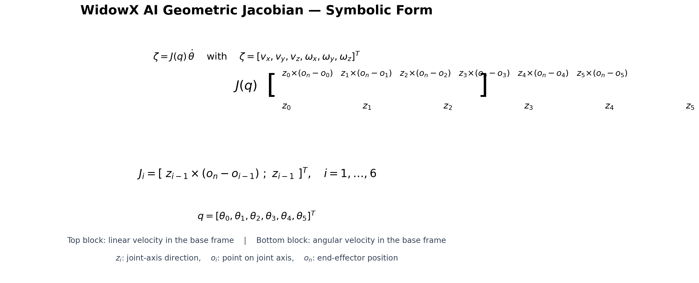
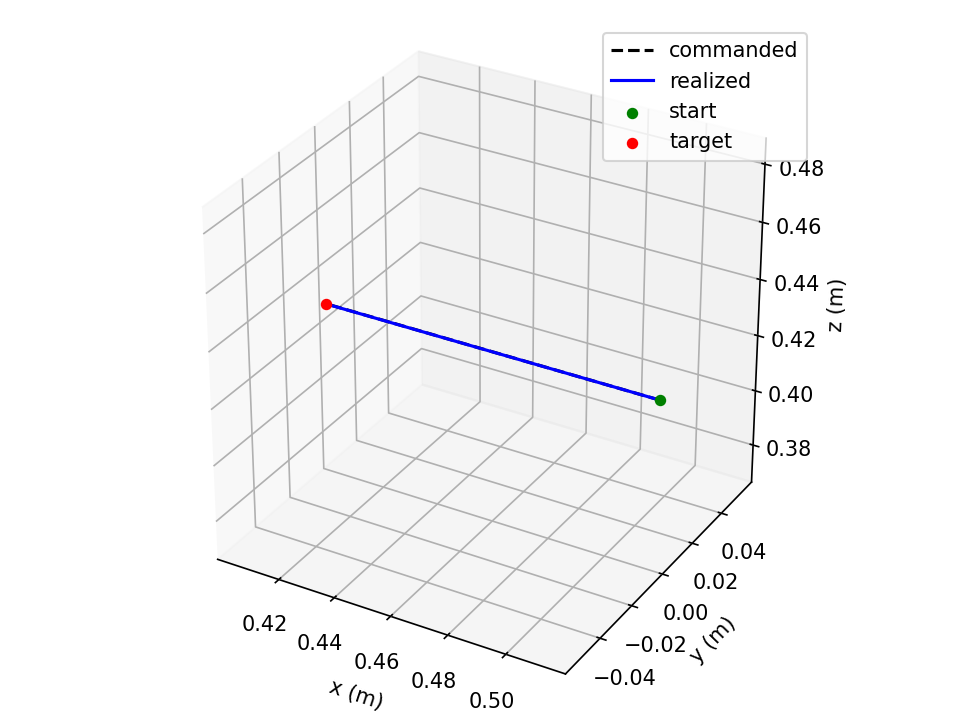
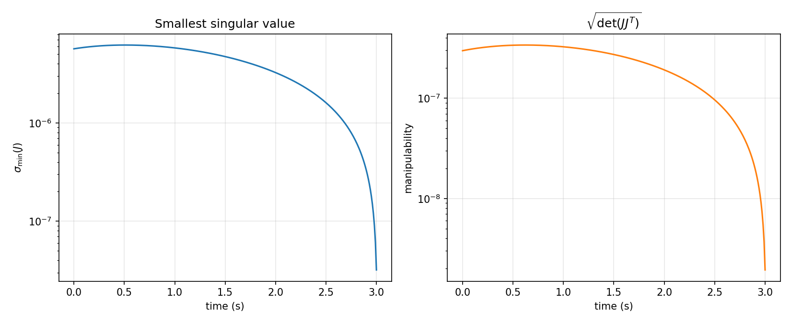
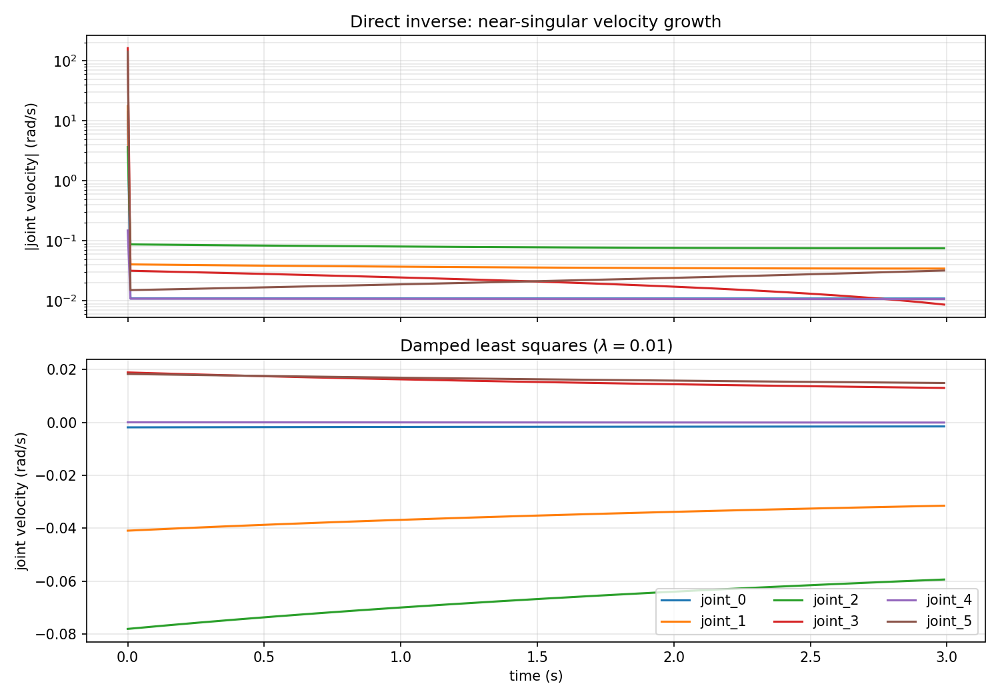

# Project 3: The Manipulator Jacobian and Velocity Control

## Conventions and forward-kinematics validation

This project studies how joint velocities affect end-effector velocity through the manipulator
Jacobian. Angles are in radians, positions are in metres, and twists are expressed in the base
frame with linear velocity first:

```math
\boldsymbol{\zeta}=[v_x,v_y,v_z,\omega_x,\omega_y,\omega_z]^T=J(q)\dot q.
```

The tool point and forward-kinematics convention are the same as in Project 2. Forward kinematics
uses the classical Denavit–Hartenberg convention. All eight reference configurations passed the
provided validation:

| Configuration | Maximum position error (mm) | Maximum orientation error (rad) |
|---|---:|---:|
| Home | 0.002000 | 0.000000 |
| Rest | 0.002000 | 0.000000 |
| Waist only | 0.001583 | 0.000002 |
| Shoulder and elbow | 0.001618 | 0.000001 |
| Wrist exercised | 0.001077 | 0.000047 |
| General A | 0.001788 | 0.000044 |
| General B | 0.001908 | 0.000034 |
| Near limits | 0.001676 | 0.000037 |

## 1. Geometric Jacobian

For each revolute joint, the Jacobian column is

```math
J_i=\begin{bmatrix}z_{i-1}\times(o_n-o_{i-1})\\z_{i-1}\end{bmatrix}.
```

The implementation obtains all intermediate frames from `fk_all_frames()`. Joint-axis directions
and points on those axes are expressed in the base frame. The upper three rows are linear
velocity and the lower three rows are angular velocity.



*Figure 1. Geometric Jacobian construction and frame convention.*

At the rest configuration (q=[0,\pi/2,\pi/2,0,0,0]\) rad, the numerical Jacobian is:

```text
[[ 0.          0.324      -0.06       -0.         -0.          0.        ]
 [ 0.51776     0.         -0.         -0.         -0.185012    0.        ]
 [-0.         -0.49776     0.49776     0.252762    -0.          0.        ]
 [ 0.          0.         -0.         -0.          0.          1.        ]
 [ 0.          1.         -1.         -1.         -0.         -0.        ]
 [ 1.          0.         -0.         -0.         -1.          0.        ]]
```

The matrix is expressed in the base frame. The first three rows have units of m/rad and the last
three rows have units of rad/rad. Columns are ordered `joint_0` through `joint_5`.

## 2. Verification against finite differences

The analytic Jacobian was checked with central differences. For column (i), the position rows
use

```math
J_{\mathrm{fd}}[:,i]=\frac{f(q+h e_i)-f(q-h e_i)}{2h}.
```

For the orientation rows, the relative rotation (R_+R_-^T) was converted to a rotation vector
using the matrix logarithm on (SO(3)), then divided by (2h). This avoids treating the difference
of two rotation matrices as a rotation.

| Quantity | Value |
|---|---:|
| Random configurations | 100, uniformly sampled within joint limits |
| Perturbation (h) | (3.16\times10^{-6}) rad |
| Largest disagreement | (5.63\times10^{-11}), Frobenius norm |
| Position-row error | (4.82\times10^{-11}), Frobenius norm |
| Orientation-row error | (4.94\times10^{-11}), Frobenius norm |

The error is not monotonic as (h) shrinks: large (h) increases truncation error, while very
small (h) increases floating-point cancellation. The selected value is near the minimum of the
worst-case error sweep.

## 3. Resolved-rate control

Joint velocities were obtained with `numpy.linalg.solve(J, zeta)`, avoiding an explicit matrix
inverse. At each integration step, the Jacobian was recomputed and the joint configuration was
updated with forward Euler integration:

```math
q_{k+1}=q_k+\Delta t\,\dot q_k.
```

| Parameter | Value |
|---|---|
| Start configuration | ([0,\pi/2,\pi/2,0,0,0]) rad |
| Goal position | ([0.400,0.000,0.4275]) m |
| Duration | 5 s |
| Time step | 0.01 s |
| Orientation command | Constant; zero angular velocity |



*Figure 2. Commanded straight-line path and realized end-effector path.*

The largest deviation from the commanded line was **0.049286 mm** over a travel distance of
approximately 117.76 mm, or about 0.042%. The deviation is nonzero because the Jacobian is a local
linearization of the nonlinear forward-kinematics mapping. The trajectory was also replayed in
RViz through `/joint_states`.

## 4. Determinant sweep

Each joint was swept across its allowed range while the remaining joints were held at the rest
configuration. Each pair below is the minimum and maximum value of \(\det(J)\) observed during the
sweep.

| Joint swept | \(\det(J)\) range | Depends on it? |
|---|---:|---|
| `joint_0` | \([-2.152227,-2.152227]\times10^{-2}\) | No |
| `joint_1` | \([-3.042027,1.966272]\times10^{-2}\) | Yes |
| `joint_2` | \([-2.252407,-0.126720]\times10^{-2}\) | Yes |
| `joint_3` | \([-2.152227,-1.714020]\times10^{-2}\) | Yes |
| `joint_4` | \([-2.152227,0]\times10^{-2}\) | Yes |
| `joint_5` | \([-2.152227,-2.152227]\times10^{-2}\) | No |

The dependence on `joint_3` and `joint_4` confirms the effect of the 67.75 mm wrist-axis offset.
Those axes are skew rather than intersecting at a common wrist centre, so the arm and wrist terms
do not separate cleanly and the determinant varies with these joint variables.

## 5. Singular configuration and proximity measure

One numerically located singular configuration is

```math
q=[-0.3998,1.2352,2.2944,0.5220,1.5708,-2.3648]\ \text{rad}.
```

The search first swept each joint to determine determinant dependence, then used differential
evolution over the joint limits to minimise the smallest singular value of (J). At the reported
configuration,

```math
\sigma_{\min}(J)\approx1.48\times10^{-19},
\qquad \det(J)\approx-9.7\times10^{-19}.
```

The Jacobian therefore has numerical rank 5. Joint 4 is at its upper limit, producing the wrist
alignment associated with this singularity.



*Figure 3. Smallest singular value and manipulability during a damped approach toward the
singular configuration. Both measures decrease as the configuration loses rank.*

## 6. Damping

The direct inverse was compared with damped least squares (DLS):

```math
\dot q=J^T(JJ^T+\lambda^2I)^{-1}\zeta.
```

The DLS run used \(\lambda=0.01\). The direct inverse produced very large joint velocities near
the singularity, while DLS kept the velocities bounded at the cost of task-space tracking error.

| Measure | Direct inverse | DLS |
|---|---:|---:|
| Maximum commanded joint speed | 163.33 rad/s | 0.0781 rad/s |
| Damping factor \(\lambda\) | n/a | 0.01 |
| Hardware execution | Not performed | Not performed |



*Figure 4. Near-singular joint velocities. The direct inverse exhibits a large initial spike;
DLS remains bounded.*


## 7. Hardware session

The hardware session was completed using Part B trajectory. A `.npz` file containing
the trajectory was generated using the straight-line control script and checked against the
hardware joint limits and velocity limit before execution. To make the first hardware run
conservative, every tenth waypoint was sent with a 1.0 s goal time, giving a maximum commanded
joint speed of 0.0089 rad/s.

Five waypoints were used for measurement: start, quarter, half, three quarters, and goal. RViz was
used to obtain the expected tool positions, and a measuring tape was used to measure the
XYZ positions. The error between measured and RViz position was:

| Point | RViz vs measured error |
|---|---:|
| Start | 7.28 mm |
| Quarter | 3.61 mm |
| Half | 5.00 mm |
| Three quarters | 14.32 mm |
| Goal | 20.22 mm |

The increasing error in the x direction suggests measurement uncertainty or a difference between
the physical ruler reference point and the modeled tool point. The complete measurements are in
`data/partD-measurements.csv`.

